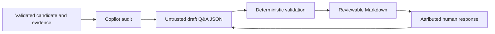

# Slice 11 Questionnaire Draft and Q&A Capture

After a validated cartographer candidate, Copilot may audit bounded citations and coverage,
correct code-answerable issues, and propose one respondent-specific draft. The draft is
untrusted JSON; deterministic tooling validates and renders it. It never creates a canonical claim.



```text
./tools/landscape questionnaire extract RESPONSE --output DRAFT
./tools/landscape questionnaire validate DRAFT
./tools/landscape questionnaire assemble BATCH_RESPONSE... --output DRAFT
./tools/landscape questionnaire consolidate DRAFT RESPONSE --output DRAFT
./tools/landscape questionnaire answers-template DRAFT --output ANSWERS.json
./tools/landscape questionnaire record DRAFT ANSWERS --output DRAFT-ANSWERED.json
./tools/landscape questionnaire render DRAFT --output QUESTIONNAIRE.md
```

`questionnaire extract` assigns the content hash ID after extracting the one untrusted JSON
object; the view-only model must omit that field.

One draft targets one respondent and carries pinned repository/evidence scope. Each item
links to one or more candidate claim IDs, exact bundle-gap descriptions, or (slice 16) observation ids, allowing one
deduplicated question to cover several repositories. `human-only` items are
respondent questions; `code-answerable` items remain visible audit work. Status is
`unanswered`, `answered`, `unknown`, or `deferred`; every response preserves exact text,
answerer, and a timezone-aware recording time. Validation is structural only: it does not
revalidate external inputs, establish business meaning, run Copilot, or promote catalog data.

## Bounded batches

A single model response may end partway through JSON. Instead of repairing it, run the
curator several times from the same frozen inputs, each time asking for a short, complete
draft-shaped object (no `id`) covering one slice, such as code-answerable audit items or
human-only questions for a subset of links. Every batch must repeat the respondent and the
scope pins it uses, and must be entirely `unanswered`.

`questionnaire assemble` validates each batch alone, then merges them deterministically:
respondents must match, a repository may not appear with conflicting commit or evidence
bundle pins, and question IDs must be unique across batches (even identical duplicates are
rejected). Scope entries and questions are sorted, and the content hash `id` is assigned
after assembly. Any truncated, empty, multi-object, answered, conflicting, or missing batch
rejects the whole assembly and nothing is written; no content is dropped or repaired.
Batch order does not affect the output.

With `--extracted-dir DIR`, a successful assembly also writes each batch as extracted and
validated (including its content-hash `id`) to `DIR/<input file stem>.extracted.json`, so
reviewers can read or diff a batch without the model's prose. This is all-or-nothing with
the draft: nothing is written on any failure, two inputs with the same stem are rejected,
and an existing file with different bytes is refused (byte-identical files are left as is).
Input response files are never modified. Failed responses stay diagnostic artifacts, and
changing batching requires restarting the affected curator flow from frozen inputs.

## Consolidation and answer capture

`questionnaire consolidate` accepts a model merge of overlapping questions only when it is
lossless: same respondent and scope, the same links per review type (none dropped or added),
no extra questions, no answers. Wording fidelity stays a human review.

`answers-template` writes a sheet listing each unanswered `human-only` question. The
respondent sets `answerer` and, per question, `answerStatus` (`answered`, `unknown`,
`deferred`; leave `unanswered` to skip) and exact `text`. `record` applies the sheet to the
draft, stamping a UTC `recordedAt` (or `--recorded-at`), and writes a new draft with a new
content hash. It rejects a sheet from another draft, unknown or duplicate IDs, empty text,
changed wording, code-answerable questions, and already-answered questions; nothing is
written on failure. Answers are attributed testimony, not source-code confirmation.

A `.md` output path makes `answers-template` write a Markdown form (one section per question
with `Status:` and `Answer:` fields) and a `.md` answers path makes `record` parse it into the
same answer-sheet structure, so the validated JSON stays the source of truth. Answer text is
the block under `Answer:` with surrounding blank lines trimmed; answer text under an
`unanswered` status is rejected rather than dropped.

Status values depend on `reviewType`: `human-only` uses `answered`, `unknown`, `deferred`;
`code-answerable` audit items use `accepted`, `rejected`, `deferred`, with the reviewer's reason
as the exact text. `answers-template --review-type code-answerable` writes the audit review
sheet, and `record` applies either kind. `answers-template` refuses to overwrite an existing
sheet unless `--force` is given.
